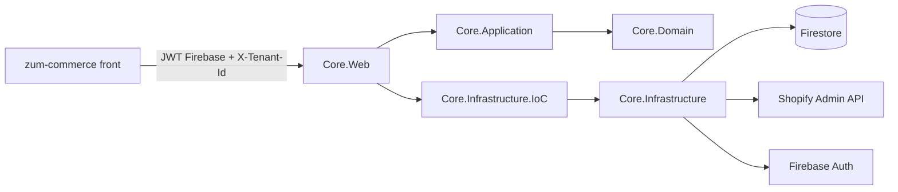

# Arquitetura do back-end



## Projetos e dependências

| Projeto | Responsabilidade | Depende de |
|---|---|---|
| `Core.Domain` | Modelos e constantes: `Tenant`, `TenantCredentials`, `TenantMember`, `Product`, `StoreCustomer`, `PagedResult` | nada |
| `Core.Infrastructure.CrossCutting` | Utilitários sem regra de negócio: telefone E.164, formato de dinheiro da Shopify, strings | Domain |
| `Core.Application` | Contratos (requests/responses), interfaces (repositórios, gateways Shopify, criptografia), `TenantAccessService` e casos de uso | Domain, CrossCutting |
| `Core.Infrastructure` | Firestore (documentos + repositórios), Shopify (token, cliente GraphQL, gateways), AES-GCM, diretório de usuários do Firebase | Application, Domain, CrossCutting |
| `Core.Infrastructure.IoC` | `AddCoreServices`: registra Firebase, Firestore, HttpClient, cache, repositórios, gateways e casos de uso | Application, Infrastructure, CrossCutting |
| `Core.Web` | `Program.cs`, controllers, autenticação Firebase, `HttpCurrentUser`, middleware de erros, health check, OpenAPI | Application, IoC |
| `tests/Core.Web.Tests` | Testes de criptografia, telefone, validação de produto, regras de acesso e montagem do `productSet` | Core.Web |

`Core.Application` não conhece Firestore nem HTTP: tudo passa por interfaces. Trocar o Firestore por PostgreSQL, por exemplo, mexe só em `Core.Infrastructure` e na IoC.

## Pastas

```text
src/
├── Core.Domain/
│   ├── Catalog/          Product, ProductOption, ProductVariant, ProductImage, ProductSummary
│   ├── Customers/        StoreCustomer, CustomerSummary
│   ├── Tenants/          Tenant, TenantCredentials, TenantMember
│   ├── Common/           PagedResult
│   └── Constants/        ProductStatuses, MemberRoles, CredentialModes, ShopifyDefaults
├── Core.Application/
│   ├── Common/           TenantIds (cabeçalho X-Tenant-Id), ShopDomains
│   ├── Configuration/    PlatformOptions
│   ├── Contracts/        Tenants, Customers, Products
│   ├── Exceptions/       AppException + AppErrorKind
│   ├── Interfaces/       ICurrentUser, ITenantRepository, ICustomerProfileRepository,
│   │                     IShopifyProductGateway, IShopifyCustomerGateway, IShopifyShopGateway,
│   │                     ISecretProtector, IUserDirectory
│   ├── Services/         TenantAccessService
│   └── UseCases/
│       ├── Tenants/      GetMe, CreateTenant, UpdateTenantCredentials, AddTenantMember, TestTenantConnection
│       ├── Products/     ListProducts, GetProduct, SaveProduct, SetProductStatus, ProductValidator
│       └── Customers/    ListCustomers, GetMyCustomerProfile, RegisterCustomer
├── Core.Infrastructure/
│   ├── Persistence/Firestore/   FirestoreCollections, Documents/, Repositories/
│   ├── Shopify/                 ShopifyTokenProvider, ShopifyGraphQLClient, ShopifyQueries,
│   │                            ShopifyProductGateway, ShopifyCustomerGateway, ShopifyShopGateway
│   ├── Security/                SecretsOptions, AesGcmSecretProtector
│   └── Identity/                FirebaseUserDirectory
├── Core.Infrastructure.CrossCutting/  Extensions/, Text/
├── Core.Infrastructure.IoC/           DependencyInjection
└── Core.Web/                          Controllers/, Authentication/, Middleware/, Properties/
```

## Multi-loja (tenants)

- Cada requisição do painel e da vitrine envia `X-Tenant-Id`. O `TenantAccessService` confere se a loja existe e está ativa e se o usuário é membro dela (`tenants/{id}/members/{uid}`). A equipe da plataforma (`Platform:AdminEmails`, com e-mail verificado) acessa todas.
- As credenciais ficam em `tenantSecrets/{id}`, criptografadas com AES-256-GCM e bloqueadas para o front pelas regras do Firestore.
- O token da Shopify de cada loja vem do fluxo *client credentials*, dura cerca de 24h e fica em cache, sendo renovado 10 minutos antes de expirar. O modo `access_token` já está pronto para o app OAuth da fase 2.

## Erros

Os casos de uso lançam `AppException` com um `AppErrorKind`, e o `ExceptionHandlingMiddleware` converte em status HTTP com `{ "error": "mensagem" }`:

| Tipo | Status |
|---|---|
| Validation | 400 |
| Unauthorized | 401 |
| Forbidden | 403 |
| NotFound | 404 |
| Conflict | 409 |
| Unprocessable (ex.: `userErrors` da Shopify) | 422 |
| ExternalService (Shopify fora/limitando) | 502 |

## Pontos de atenção

- **`productSet` trata listas como completas**: as variações e as fotos não enviadas são apagadas. Por isso a API reenvia as fotos existentes por `id` e as variações com seus `id`.
- **Estoque na edição**: o estoque vai em `inventoryQuantities` dentro do `productSet`. Se, na versão da API em uso, isso não atualizar produtos já existentes, troque por `inventorySetQuantities`.
- **Dados protegidos de clientes**: a lista de clientes depende do acesso a nome, e-mail e telefone aprovado no app da Shopify.
